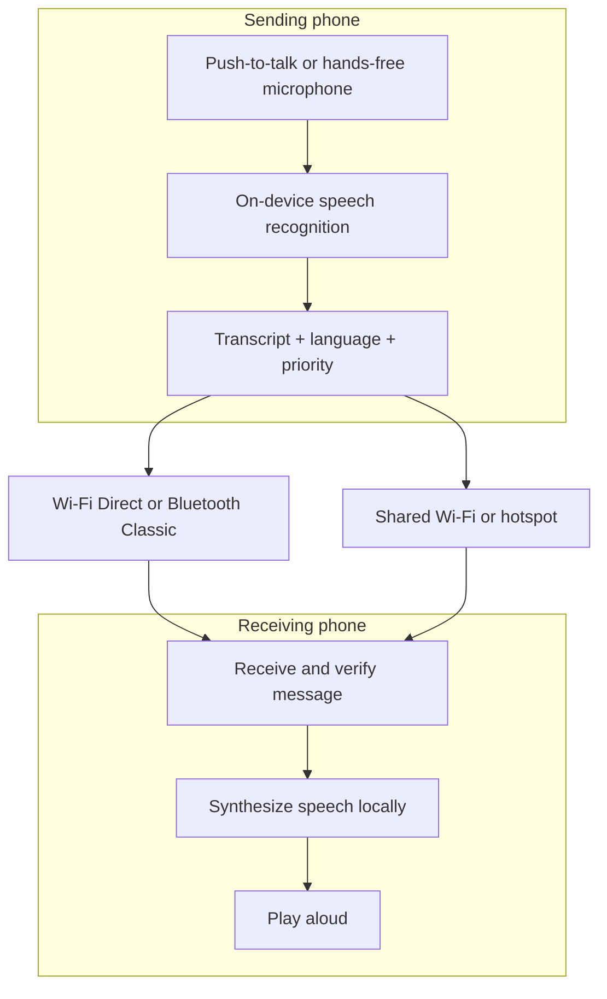

# iTantra

iTantra lets nearby Android phones exchange spoken messages offline in ten languages.
Hold to talk or use hands-free mode. Your phone transcribes what you say, sends the
transcript over a local link, and the receiving phone reads it aloud in the
original language. The audio stays on the sender’s phone, so the link only needs
to carry text and message metadata.

Built for Smart India Hackathon problem statement 26173, *Indian multilingual
TTS and STT for low-bitrate links*.

**Android 8.0+ (API 26) · arm64-v8a · Kotlin + Jetpack Compose**

Version `0.9.1-emergency-alert` (code 24)

## How a voice message travels



Silero VAD detects pauses. Moonshine transcribes English, and IndicConformer
handles the other nine languages. The app encodes the text and metadata in a
checksummed Protocol Buffers message. On receipt, eSpeak NG can read any supported
language immediately. An installed neural voice can provide playback instead.

Wi-Fi Direct and Bluetooth Classic connect two phones. On shared Wi-Fi or a
hotspot, users can also host a local group. Receipts distinguish delivery,
playback and acknowledgement.

**Emergency SOS** also supports an experimental public BLE mode. Participating
phones must enable **Receive & auto-forward**. An alert can then travel up to
three radio hops. The sender has three seconds to cancel before transmission,
and an incoming emergency alert can sound an alarm, vibrate and be read aloud.
[Public BLE SOS guide](docs/PUBLIC_BLE_SOS.md)

## Try it on two phones

1. Install the app on both phones. For an English or Hindi demo, the preloaded
   build includes recognition and voice packs. With the base build, import a
   recognition pack under **Models** on the phone you’ll speak into.
2. Connect both phones to the same Wi-Fi or hotspot. Open **Connections** and
   create a local group on one phone, then join it from the other.
3. Select the installed recognition language and send a push-to-talk message
   to the group. The other phone can read it aloud with its built-in voice,
   even without a recognition pack. Check the receipt to see when it played.

## Languages

Every language speaks out of the box with the built-in voice. Speech to text and
natural voices are optional packs, installed per language.

| Language | Speech to text | Built-in voice (eSpeak NG) | Natural voice (neural) | In preloaded APK |
|---|---|---|---|---|
| Bengali · বাংলা | ✅ IndicConformer · 197.7 MB | ✅ Included | ✅ 118.9 MB | — |
| English | ✅ Moonshine Small · 142.3 MB<br>✅ Moonshine Tiny · 45.3 MB (low-end phones) | ✅ Included | ✅ 118.9 MB | Speech to text + voice |
| Gujarati · ગુજરાતી | ✅ IndicConformer · 197.7 MB | ✅ Included | ✅ 118.9 MB | — |
| Hindi · हिन्दी | ✅ IndicConformer · 197.7 MB | ✅ Included | ✅ 118.9 MB | Speech to text + voice |
| Kannada · ಕನ್ನಡ | ✅ IndicConformer · 197.7 MB | ✅ Included | ✅ 118.9 MB | — |
| Malayalam · മലയാളം | ✅ IndicConformer · 197.7 MB | ✅ Included | ✅ 118.9 MB | — |
| Marathi · मराठी | ✅ IndicConformer · 197.7 MB | ✅ Included | ✅ 118.9 MB | — |
| Odia · ଓଡ଼ିଆ | ✅ IndicConformer · 197.7 MB | ✅ Included | ✅ 183.6 MB | — |
| Tamil · தமிழ் | ✅ IndicConformer · 197.7 MB | ✅ Included | ✅ 118.9 MB | — |
| Telugu · తెలుగు | ✅ IndicConformer · 197.7 MB | ✅ Included | ✅ 118.9 MB | — |

- **Built-in voice:** eSpeak NG is inside every APK (about 3 MB for all ten
  languages). It is the default, the fallback when a natural voice is missing or
  fails. Emergency playback can reuse a matching neural voice already in memory.
- **Natural voices:** AI4Bharat Indic-TTS (FastPitch + HiFi-GAN). Quality has not
  been rated by native speakers yet.
- **Sizes** are installed model sizes in decimal MB, from `models/models.lock.json`.
  Only one speech-to-text model and at most one natural voice are loaded at a time.
- **Receiving needs no matching pack:** a phone speaks an incoming message in its
  language even if it has no speech-to-text pack for that language.

## Measured on a phone

Results from **More → Diagnostics** on a Moto G34 5G:

| Metric | Result |
|---|---|
| Speech-to-text real-time factor | 0.13 |
| End of speech to message fully played | 3.43 s |
| CPU while listening (hands-free) | 11.11% of one core |
| Text-to-speech real-time factor (neural voice) | 1.77 |

Word error rate has not been measured yet; it needs a scored recording set per
language.

## Build

Requirements: Java 17, Android SDK with NDK and CMake 3.22.1, PowerShell.

The models and two prebuilt runtimes are not in this repository:

1. **sherpa-onnx 1.13.8 AAR** → `third_party/sherpa-onnx/sherpa-onnx-1.13.8.aar`
   (from the [sherpa-onnx releases](https://github.com/k2-fsa/sherpa-onnx/releases)).
2. **Moonshine runtime** → run `python scripts/prepare-moonshine-small.py`. The
   build checks the resulting AAR against a pinned SHA-256.
3. **eSpeak NG voice data** → run `scripts/build-espeak-data.ps1`.
4. **Silero VAD** → `models/source/vad/silero_vad.int8.onnx` (pinned in
   `models/models.lock.json`).

Then:

```powershell
$env:JAVA_HOME = '<path to JDK 17>'
.\gradlew.bat :app:testBaseDebugUnitTest :app:lintBaseDebug :app:assembleBaseDebug
```

`assembleDemoPreloadedDebug` builds the larger demo APK, which bundles English and
Hindi speech-to-text and voices. It needs the packs in `models/packs/`; see
[models/README.md](models/README.md) and the scripts in `scripts/`.

Language and voice packs (`.itpack`) are imported from local storage in the app
under **Models**. Each file is checked against the SHA-256 values in
`models/models.lock.json` before it is used.

## Documentation

- [Neural voices](docs/NEURAL_TTS.md)
- [Emergency SOS flow](docs/SOS_FLOW.md) · [Public BLE SOS](docs/PUBLIC_BLE_SOS.md)
- [Local groups](docs/LOCAL_GROUPS.md)
- [Product requirements](ITANTRA_PRD.md)
- [Test and device results](docs/results/README.md)
- [Licences overview (PDF)](docs/legal/LEGAL.pdf)

## Licence

iTantra is licensed **GPL-3.0-or-later** ([LICENSE](LICENSE)), because it links
eSpeak NG. Every bundled or importable component keeps its own licence; see
[THIRD_PARTY_NOTICES.md](THIRD_PARTY_NOTICES.md) and [licenses/](licenses/).
The AI4Bharat Indic-TTS voices are MIT as declared by their publisher; the
upstream repository ships no licence file, so verify before redistributing.

No hosted speech-to-text or text-to-speech service is used. Delivery is not
guaranteed, and iTantra is not a replacement for emergency services.
